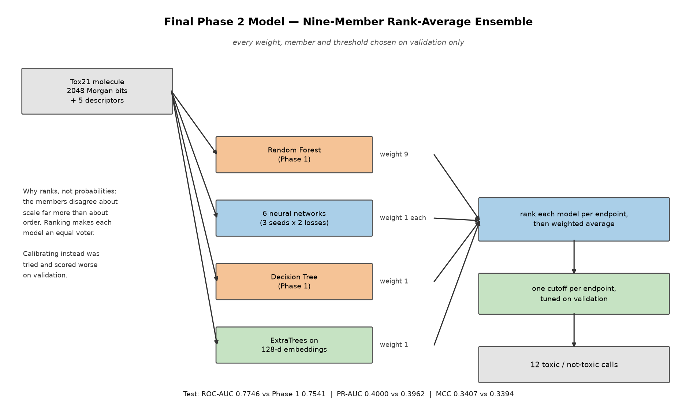

# Molecular Toxicity Prediction (Tox21)

Predicting whether a molecule is toxic across 12 biological endpoints, from its
chemical structure alone.

---

## 1. Introduction

Testing a new chemical for toxicity in a laboratory is slow and expensive. If a
computer can read a molecule's structure and flag the risky ones first, the
laboratory work can be pointed at the compounds that matter.

This project builds that filter. It was done in two phases:

* **Phase 1** established a baseline with classical machine learning — Logistic
  Regression, a Decision Tree, and a Random Forest.
* **Phase 2** added deep learning, a feature-level hybrid, and an ensemble, then
  checked honestly whether any of it actually beat Phase 1.

The short answer: **Phase 2 is better, clearly on ROC-AUC and marginally
elsewhere.** Section 9 gives the numbers without rounding the awkward parts off.

---

## 2. Problem Statement

Given a molecule, predict for each of **12 toxicity endpoints** whether it is
active (toxic) or inactive. Three things make this harder than ordinary
classification:

1. **Severe class imbalance.** Depending on the endpoint, only 2.5%–15% of
   molecules are toxic. A model that answers "not toxic" every time scores over
   90% accuracy and is useless, which is why accuracy is never reported here.
2. **Missing labels.** About 17% of the molecule–endpoint pairs were simply
   never measured. A missing measurement is *not* evidence of non-toxicity, so
   it must be excluded rather than filled with a zero.
3. **Generalising to new chemistry.** A model that only works on molecules
   resembling its training set is not useful, so the data is split by chemical
   scaffold rather than at random.

---

## 3. Dataset

The **Tox21** public dataset.

| | |
|---|---|
| Molecules (after cleaning) | 7,823 |
| Endpoints | 12 (7 nuclear receptor, 5 stress response) |
| Missing labels | ~17.1% of all molecule–endpoint pairs |
| Split | Bemis–Murcko scaffold split: 6,259 train / 782 validation / 782 test |

Each molecule is represented by **2,053 numbers**: 2,048 Morgan fingerprint bits
(radius 2) describing which substructures are present, plus 5 RDKit descriptors
(molecular weight, polar surface area, logP, H-bond donors, H-bond acceptors).

**The scaffold split matters.** Molecules sharing a core structure are kept
together in one split, so the test set contains chemistry the model has never
seen. A random split would place near-identical molecules on both sides and
quietly inflate every score.

This split was frozen in Phase 1 and **never regenerated**. Every model in both
phases is measured on the same 782 test molecules and the same observed labels.

---

## 4. Phase 1 — The Baseline

Three classical models, one per endpoint (36 models total), each trained only on
the molecules whose label for that endpoint was actually measured.

| Model | Test ROC-AUC |
|---|---|
| **Random Forest** | **0.7541** |
| Logistic Regression | 0.7152 |
| Decision Tree | 0.6428 |

All use `class_weight="balanced"` to stop the majority class from dominating.
The Random Forest became the baseline that Phase 2 had to beat.

Phase 1 is **frozen**. Its files were not modified during Phase 2.

---

## 5. Phase 2 — What Was Added

1. **A multi-task neural network** that predicts all 12 endpoints at once.
2. **A feature-level hybrid** — a tree model trained on the network's learned
   128-dimensional representation.
3. **Ablation studies** on dropout, class weighting, and multi-task versus
   single-task learning.
4. **An ensemble** combining the strongest members.
5. **A SMILES Transformer experiment**, which did not work and was archived with
   its results kept.

The full experimental record is in **[`phase2/experiments/PART_A_RESULTS.md`](phase2/experiments/PART_A_RESULTS.md)**.

### The bug that mattered most

The training loop saved its best checkpoint like this:

```python
best_state = {"model_state_dict": self.model.state_dict()}   # wrong
```

`state_dict()` returns *references* to the live parameter tensors, not copies.
As training continued, `best_state` silently followed the model, so restoring
"the best model" at the end actually restored the **final** epoch. The file
saved to disk was fine; the model held in memory was not.

Because the network overfits after **two epochs** (training loss falls to 0.15
while validation loss triples to 4.0), this was not a small difference. It
depressed the reported deep learning score *and* corrupted the embeddings handed
to the hybrid. Fixed with `.clone()`.

---

## 6. Models Used

| Model | Type | Test ROC-AUC |
|---|---|---|
| **Nine-member ensemble** | prediction ensemble | **0.7746** |
| Random Forest (Phase 1) | classical ML | 0.7541 |
| Deep learning, 6-run average | neural network | 0.7680 |
| Multi-task network, single run | neural network | 0.7318 |
| Feature hybrid (ExtraTrees on embeddings) | hybrid | 0.7294 |
| ANN + Transformer (archived) | neural network | 0.7339 |
| Logistic Regression (Phase 1) | classical ML | 0.7152 |
| Decision Tree (Phase 1) | classical ML | 0.6428 |

The neural network is a plain feedforward MLP:

```
2053 → 512 → 256 → 128 → 12
```

with BatchNorm, ReLU and dropout at each hidden layer. The 128-dimensional layer
is the "latent" representation reused by the hybrid. The loss is binary
cross-entropy masked so unmeasured labels contribute exactly zero.

---

## 7. The Hybrid Model

The idea: let the neural network learn a compact 128-number summary of each
molecule, then train a Random Forest on that summary plus the 5 descriptors
(133 features total) instead of on the raw 2,053.

**It did not work.** Even after fixing the checkpoint bug and switching to
ExtraTrees, it reaches 0.7294 against the plain Random Forest's 0.7541.

Three honest reasons:

1. **The bottleneck discards information.** 2,053 features are compressed to
   128. The forest can only use what survived; the standalone forest sees all
   2,048 fingerprint bits.
2. **The embedding was shaped for a linear layer, not for trees.** It was
   trained so a single `Linear(128, 12)` could separate the classes. A tree
   splits one axis at a time. The evidence is direct: the linear head on the
   embedding scores higher than a forest on the same embedding.
3. **Forests are already good at sparse binary fingerprints.** There was little
   room for a learned representation to add value.

**This is a legitimate result, not a failure.** The brief asked whether the
hybrid improves performance; the evidence says it does not, and that is
reported rather than hidden. Full analysis: [`docs/hybrid_model.md`](docs/hybrid_model.md).

Interestingly, the hybrid still earns a place *in the ensemble* — its
predictions correlate only about 0.5 with the Random Forest's, so it makes
different mistakes, and an ensemble benefits from that.

---

## 8. Architecture of the Final Model



Nine members vote. Each produces a probability per endpoint; those are converted
to **ranks** within each endpoint, averaged with the Random Forest counting nine
times, and one cutoff per endpoint (tuned on validation) turns the result into a
decision.

**Why ranks rather than probabilities?** The members disagree about *scale* far
more than about *order*. Averaging raw probabilities lets whichever model is
most confident dominate; averaging ranks makes every model an equal voter.
Isotonic calibration was tried instead and scored **worse** on validation, so it
was rejected — see `PART_A_RESULTS.md` section 7.

---

## 9. Phase 1 vs Phase 2

Both measured on the same 782 test molecules, same observed labels, with
per-endpoint cutoffs tuned on validation.

| Metric | Phase 1 RF | Phase 2 ensemble | Change |
|---|---|---|---|
| ROC-AUC | 0.7541 | **0.7746** | **+0.0205** |
| PR-AUC | 0.3962 | **0.4000** | +0.0038 |
| F1 | 0.3979 | **0.3990** | +0.0011 |
| MCC | 0.3394 | **0.3407** | +0.0013 |
| Precision | **0.4627** | 0.4312 | −0.0315 |
| Recall | 0.3703 | **0.4499** | +0.0796 |

**Read this carefully, because the sizes differ enormously:**

* **ROC-AUC +0.0205 is a genuine improvement.** It clears the measured
  seed-to-seed spread of 0.02, and it holds on **all 12 endpoints
  individually** — luck does not do that.
* **PR-AUC, F1 and MCC are ties.** Those gains are roughly ten times *smaller*
  than the noise level. The honest claim is "Phase 2 no longer loses on these",
  not "Phase 2 wins on these".
* **Precision and recall trade off**, as they always do when a threshold moves.
  The ensemble catches more toxic molecules (recall 0.45 vs 0.37) at the price
  of more false alarms — usually the right trade for a screening tool, but a
  choice, not a free gain.

So: **Phase 2 clearly ranks molecules better than Phase 1, and matches it on
threshold-based metrics.**

Every weight, member and threshold was selected on the **validation** split. The
test set was scored once, at the end.

---

## 10. Install and Run

### Setup

```bash
git clone <repository-url>
cd Molecular-Toxicity-Prediction-
```

```bash
python3 -m venv .venv && source .venv/bin/activate
```

```bash
pip install -r requirements.txt -r phase2/requirements.txt
```

`requirements.txt` is Phase 1's; `phase2/requirements.txt` covers Phase 2.
`scikit-learn` is pinned to 1.9.1 because the saved `.joblib` hybrid models were
written by that version and joblib does not guarantee cross-version loading.

### Run the dashboard

```bash
streamlit run app.py
```

### Run the tests

```bash
python3 -m unittest phase2.data.tests.test_data_pipeline phase2.deep_learning.tests.test_dl_model phase2.evaluation.tests.test_evaluation
```

### Reproduce the Phase 2 result

Each script prints its own runtime. None of these trains a neural network;
they read checkpoints and predictions that already exist.

```bash
python3 -m phase2.experiments.improve_ensemble
```

```bash
python3 -m phase2.experiments.final_comparison
```

To retrain from scratch instead (several minutes each):

```bash
python3 -m phase2.deep_learning.train
```

```bash
python3 -m phase2.hybrid.train_hybrid
```

### A note on archived checkpoints

To keep the repository manageable, 196 MB of checkpoints were moved to
`archive/` (which is git-ignored, not deleted):

* the 36 single-task ablation models — their conclusion is already saved in
  `phase2/results/metrics/multitask_vs_single_task*.csv`
* the dropout-ablation models — same reason

Regenerate them with `python3 -m phase2.evaluation.run_all` if needed. The
checkpoints the current code actually loads are still in place.

---

## 11. Folder Structure

```
.
├── app.py, train_models.py, evaluate.py     Phase 1 (frozen, do not edit)
├── results/                                 Phase 1 metrics and plots
├── tox21_project/, tox21_member2_handoff/   data and prepared features
│
├── phase2/
│   ├── data/            loader, split handling, label masks
│   ├── deep_learning/   the MLP: model, trainer, embeddings
│   ├── hybrid/          feature-level hybrid, 12 saved forests
│   ├── evaluation/      metrics, ablations, error analysis
│   ├── experiments/     ensembles and the final comparison
│   ├── results/
│   │   ├── metrics/     every result CSV
│   │   ├── plots/       every figure
│   │   └── predictions/ saved model predictions
│   └── requirements.txt
│
├── docs/                detailed analyses
├── archive/             heavy checkpoints and abandoned work (git-ignored)
└── README.md
```

All Phase 2 scripts write their output to `phase2/results/`. The four paths are
defined once, in `phase2/data/src/data_loader.py`.

---

## 12. Team Contributions

<!--
  TO BE COMPLETED — do not guess this section.

  Phase 1 and Phase 2 use different member numbering: in app.py, Member 3 is
  the baseline classifiers, while in phase2/, Member 3 was the hybrid model.
  Folder names are no longer a guide either, since they were renamed to
  function names during the Phase 2 cleanup.

  Fill in each person's name against the work they actually did:
    - Tox21 data pipeline, scaffold split, feature generation, label masks
    - Phase 1 baseline classifiers (Logistic Regression, Decision Tree, RF)
    - Multi-task deep learning model and training pipeline
    - Feature-level hybrid model
    - Evaluation, ablation studies and error analysis
    - Streamlit dashboard and presentation
    - Phase 2 ensemble and final model selection
-->

*This section is pending — it will be filled in once the team confirms who did
what, rather than inferred from folder names.*

---

## 13. Further Reading

| Document | Contents |
|---|---|
| [`phase2/experiments/PART_A_RESULTS.md`](phase2/experiments/PART_A_RESULTS.md) | The full experimental record and every decision |
| [`docs/hybrid_model.md`](docs/hybrid_model.md) | Why the hybrid loses; leakage controls |
| [`docs/data_pipeline.md`](docs/data_pipeline.md) | Split contract, feature spaces, class weights |
| [`docs/deep_learning.md`](docs/deep_learning.md) | Network architecture and masked loss |
| [`docs/evaluation.md`](docs/evaluation.md) | Benchmarks, ablations, viva questions |
